# 6. Neural Networks

## Materials

- 📄 Slides: [6-nns.pdf](6-nns.pdf)
- 📓 Notebook 1: [01-neural-networks-basics.ipynb](01-neural-networks-basics.ipynb)

## Activation Functions

<a href="activation-functions/sigmoid_function.png">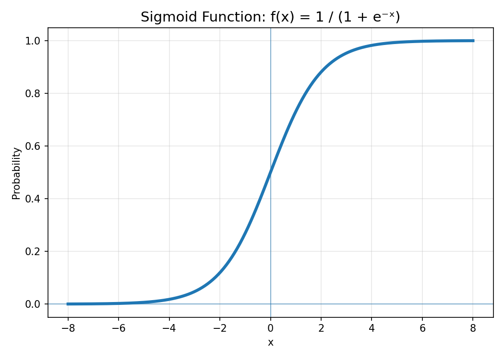</a>
<a href="activation-functions/tanh_function.png">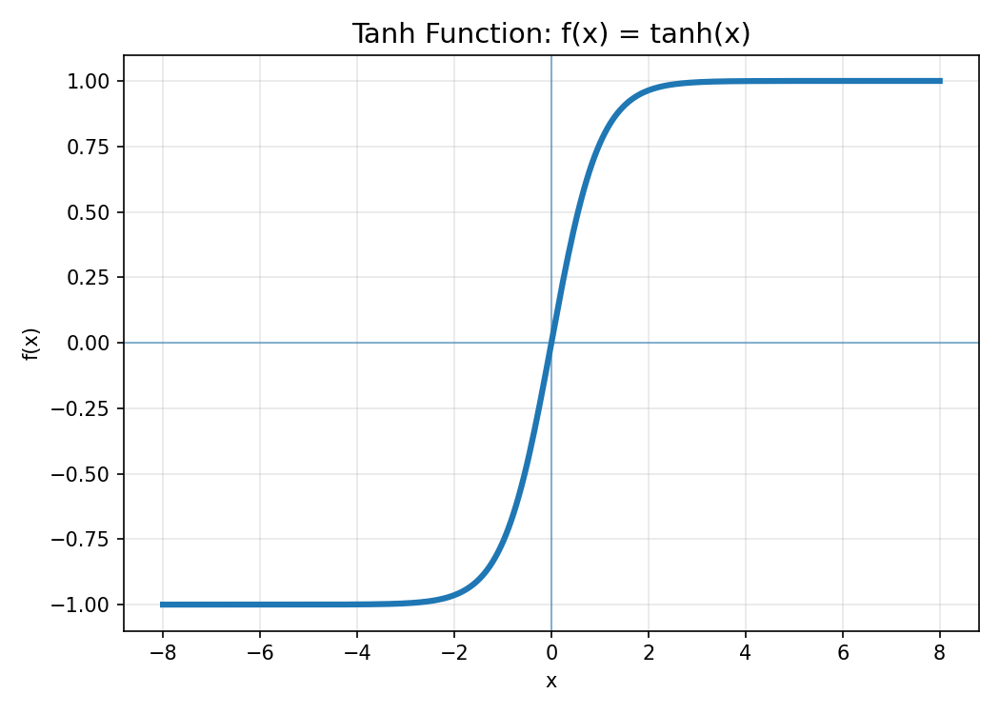</a>
<a href="activation-functions/relu_function.png">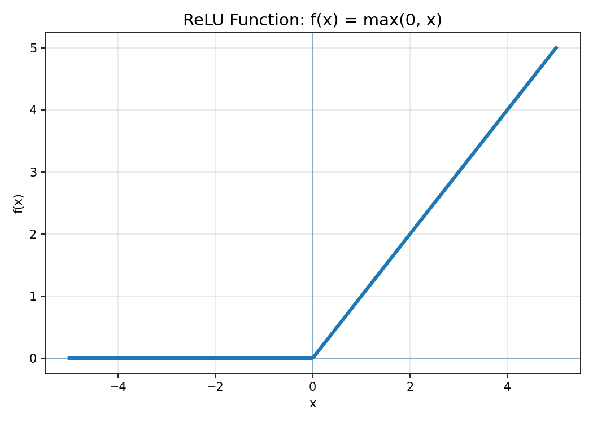</a>
<a href="activation-functions/leaky_relu_function.png">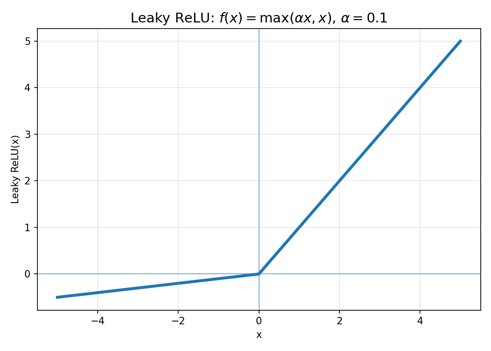</a>
<a href="activation-functions/gelu_function.png">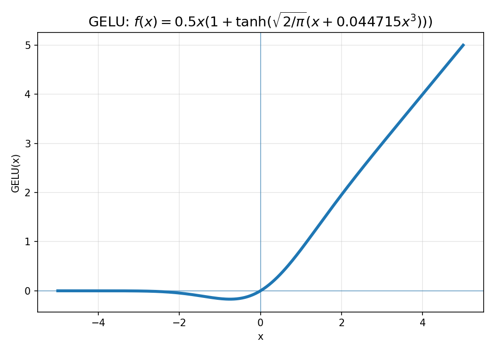</a>
<a href="activation-functions/swish_silu_function.png">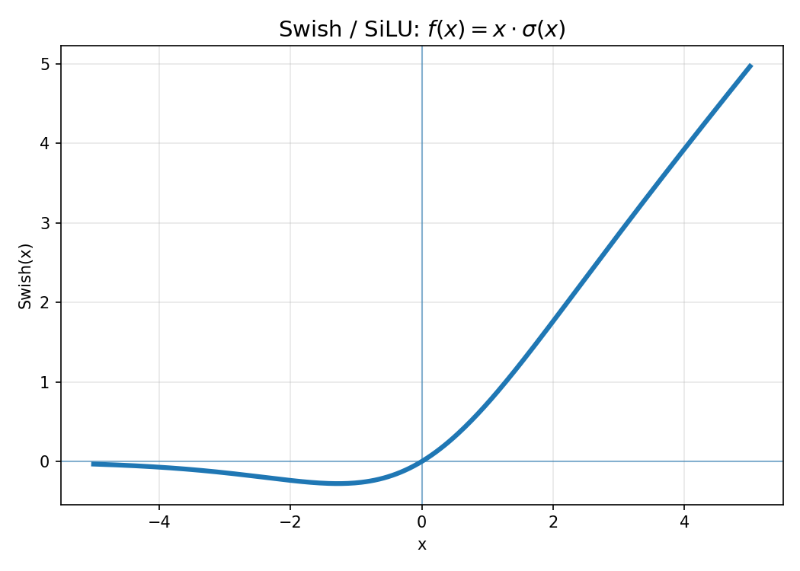</a>
<a href="activation-functions/softmax_function.png">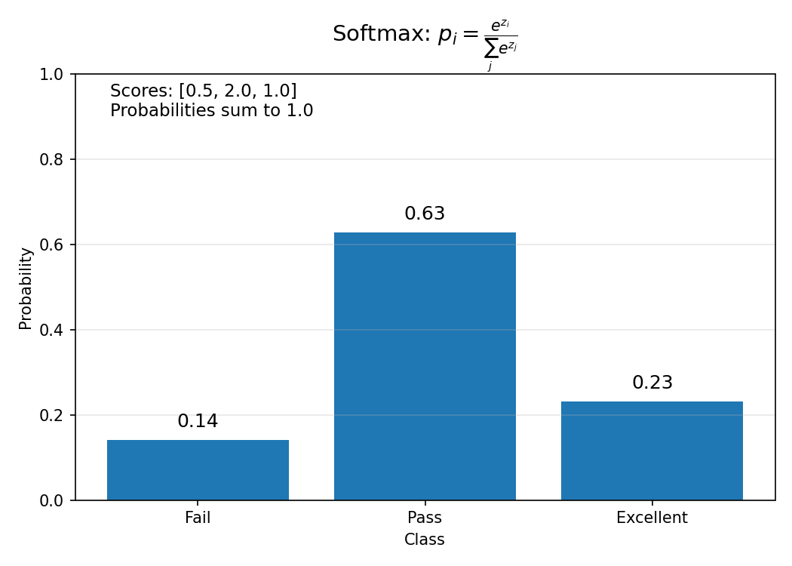</a>
<a href="activation-functions/linear_identity_function.png">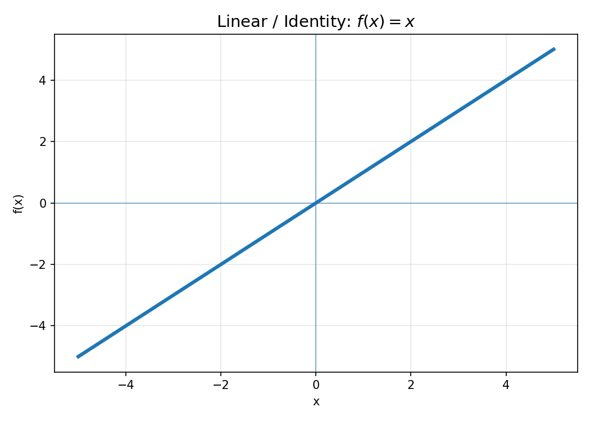</a>
<a href="activation-functions/quadratic_function.png">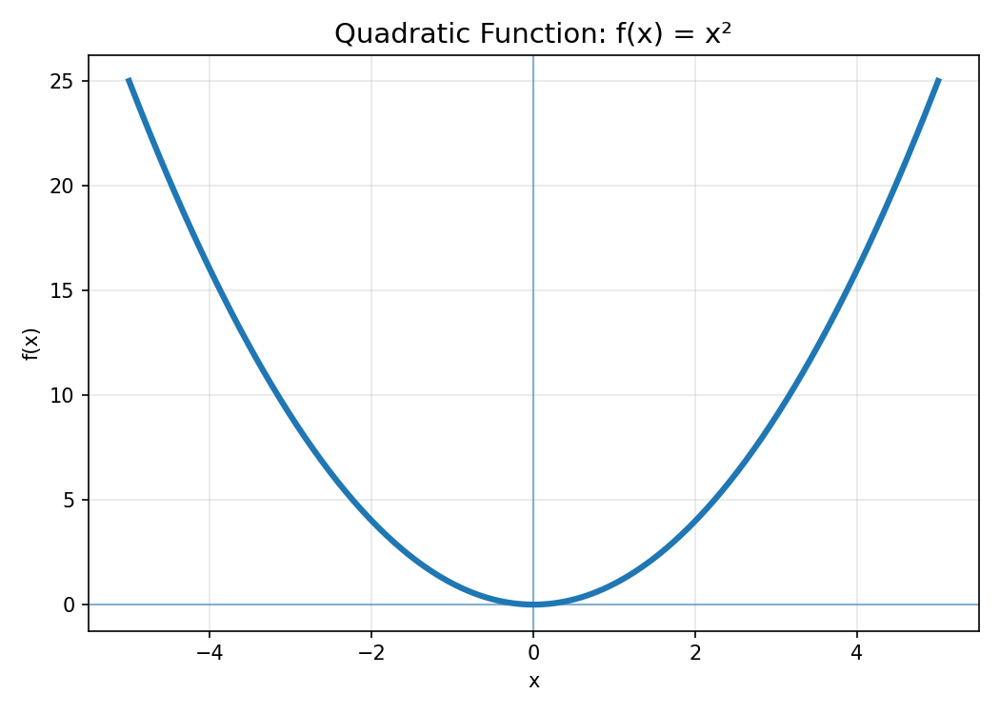</a>
<a href="activation-functions/cubic_function.png">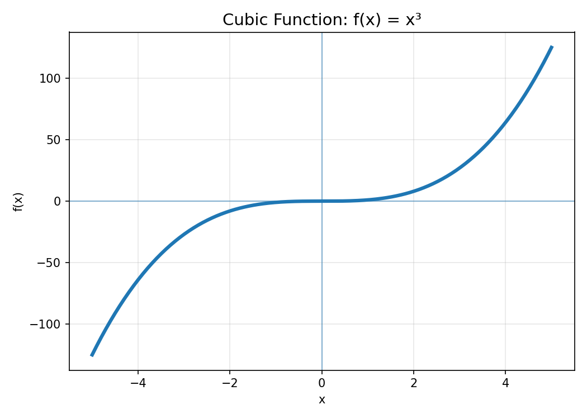</a>
<a href="activation-functions/exponential_function.png">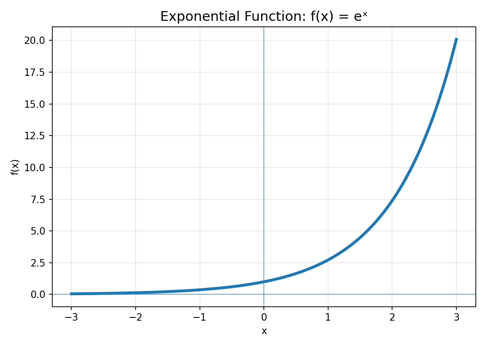</a>
<a href="activation-functions/logarithmic_function.png">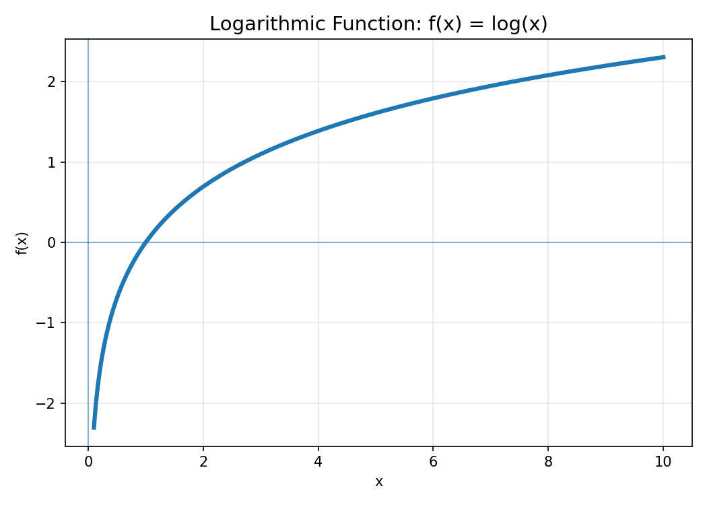</a>
<a href="activation-functions/sine_function.png">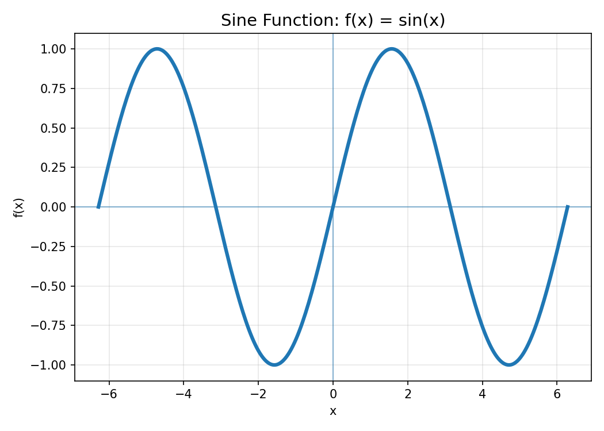</a>

---

## Clone the Repository

Open a terminal and run:

```bash
git clone https://github.com/EmanuelaBoros/ml-course.git
```

Then move into the course folder:

```bash
cd ml-course/docs/6-Neural-Networks
```

### Open the Notebook

Start Jupyter Notebook:
```bash
jupyter notebook
```

Then open the notebooks.
